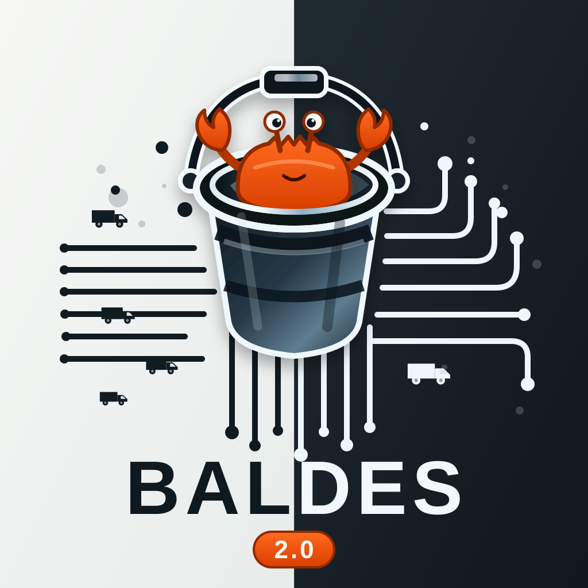
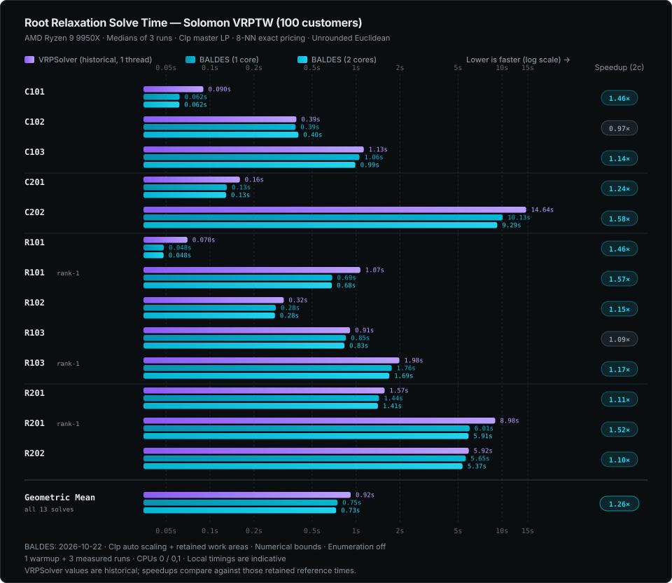

<div align="center">



<br>


</div>

# BALDES 2.0

BALDES is a Rust toolkit for vehicle routing, with bucket-graph pricing,
branch-cut-and-price, and a Hybrid Genetic Search (HGS) heuristic. Use it from
the command line, Python through **pybaldes**, or the Rust library.

It reads Solomon VRPTW and CVRPLIB CVRP instances. See the
[documentation](docs/README.md) for solver configuration and advanced usage.

## Performance

Root relaxation solve times against **VRPSolver / BaPCod** on Solomon VRPTW
instances with 100 customers:



Times are medians of three runs on an AMD Ryzen 9 9950X, using the same graph,
NG neighborhoods, and Clp master, with reduced-cost fixing and enumeration
disabled. The reference uses one thread; BALDES is measured on one and two
cores. See the [benchmark guide](docs/benchmarks/root.md) for the full setup.

## Install

Clone the repository with its solver dependencies:

```bash
git clone --recurse-submodules https://github.com/lseman/baldes.git
cd baldes
```

### Command line

Install Rust/Cargo and a C++14 compiler, then build:

```bash
cargo build --release --features clp
./target/release/baldes --help
```

The executable is `target/release/baldes`. You can also use `make config`
and `make` for an interactive build setup. Optional backends and library-only
builds are covered in the [build guide](docs/guides/build.md).

### Python

With Python 3.9+ and the same build prerequisites, install from the checkout:

```bash
python -m pip install .
```

The package and import name are both `pybaldes`. Its default build includes
the Clp master needed for routing root solves.

## Run

Solve a root relaxation with time windows:

```bash
./target/release/baldes solve instances/R101.txt --customers 25 --time 60 --verbose
```

Find a feasible capacitated routing solution with HGS:

```bash
./target/release/baldes hgs instances/cvrplib/A-n32-k5.vrp --time 10
```

Run branch-and-price for an integer routing solution:

```bash
./target/release/baldes solve instances/cvrplib/A-n32-k5.vrp --tree --time 60
```

Routing commands solve the root LP relaxation by default; add `--tree` for
integer routing. A root result with status `Optimal` means the relaxation
converged. HGS is a heuristic and does not prove optimality.

Use `--json result.json` to save results. The [CLI guide](docs/guides/cli.md) covers
input formats and options, including cuts, master solvers, HGS seeding,
and progress logging.

## Use pybaldes

`solve_root` reads an instance, runs the Rust solver, and returns a typed result
with bounds, routes, and iteration history:

```python
import pybaldes

result = pybaldes.solve_root(
    "instances/R101.txt",
    problem_type="vrptw",
    customers=25,
    time_limit=60,
)
print(result.status, result.lp, result.bound)
for route in result.routes:
    print(route.value, route.cost, route.nodes)
```

Route values can be fractional because this API solves the root relaxation.
Use `problem_type="cvrp"` for capacitated routing without time windows.

You can also construct an `Instance` in memory, configure cuts and master
solvers, or use the low-level `Solver` for pricing. See the
[Python guide](docs/guides/python.md) for examples, options, and result export.

## Documentation

- [Build and installation](docs/guides/build.md)
- [CLI usage and options](docs/guides/cli.md)
- [Python API](docs/guides/python.md)
- [Branch-and-price](docs/solver/tree.md)
- [Pricing controls](docs/reference/options.md)
- [Algorithms and references](docs/reference/algorithms.md)
- [All guides](docs/README.md)

## Citation

If you use BALDES in academic work, please cite:

```bibtex
@Misc{BucketGraphLabeling,
  author       = {Laio Oriel Seman and Pedro Munari and Teobaldo Bulh\~oes and Eduardo Camponogara},
  title        = {BALDES: a modern C++ Bucket Graph Labeling Algorithm for Vehicle Routing},
  howpublished = {\url{https://github.com/lseman/baldes}},
  year         = {2024},
  note         = {GitHub repository},
  urldate      = {2024-09-17},
  month        = sep
}
```

## License

MIT. See [LICENSE](LICENSE).
