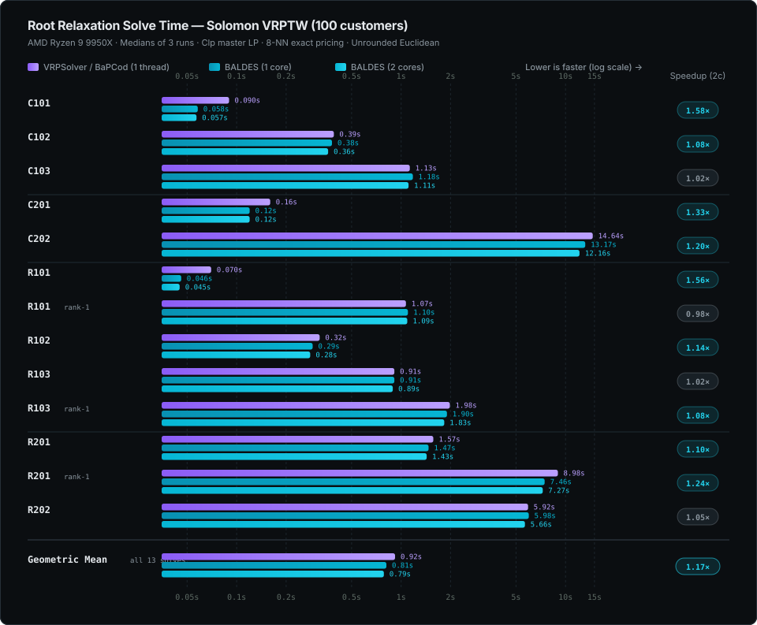

# Root benchmarks

[Documentation index](README.md) · [Build and validation](testing.md)

Root relaxations of Solomon VRPTW instances (100 customers), using split-depot
graphs, unrounded Euclidean distances, NG neighbourhoods of the 8 nearest
customers, the Clp master, and no reduced-cost fixing or enumeration. Times are
the solvers' own root timers, reported as medians of three runs on an AMD
Ryzen 9 9950X.

The chart retains the **historical VRPSolver one-thread measurements** and
refreshes **both BALDES series on October 20, 2026**. BALDES uses automatic Clp
scaling, retained work areas and numerical bounds, with optional SIMD disabled.
Its forward/backward exact pricing uses two threads; one-core and two-core runs
are pinned to CPU 0 and CPUs 0/1 respectively (different physical cores).
One warmup precedes three measured runs per case/core configuration, alternating
core configurations. Other work was running on the machine, so the new times
are indicative; the displayed speedups compare against historical reference
values rather than a fresh paired reference run.



On C101–C103, C201, C202 and R102, rank-one separation finds no violated cut,
so those runs equal the ones without cuts.

## Current chart refresh (October 20, 2026)

The initial refresh used CPUs 14/15 instead of the earlier CPUs 0/1. A
[paired regression check](runtime-regression-check-20261020.md) found different
effective clock rates between those core groups and additional timing variation.
The chart now consistently uses CPU 0 and CPUs 0/1. On matched CPUs 0/1, saved
portable/current-default medians were 5.6933/5.5844 s on R202 and 1.8307/1.6871 s
on R103 rank-one; the suspected regression did not reproduce.

All 104 warmup/measured runs in the corrected chart batch finished with optimal
root LP termination. Every non-timing JSON field matches the preceding 14/15
chart batch, including histories, routes, work counts, objectives and bounds.
This is root LP termination, not a general integer optimality certificate.

| Workload | One core | Two cores |
| --- | ---: | ---: |
| C101 | 0.0617 s | 0.0616 s |
| C102 | 0.3819 s | 0.3652 s |
| C103 | 1.0354 s | 0.9654 s |
| C201 | 0.1277 s | 0.1264 s |
| C202 | 10.6514 s | 9.7075 s |
| R101 | 0.0482 s | 0.0481 s |
| R101-rank1 | 1.1443 s | 1.1409 s |
| R102 | 0.2883 s | 0.2839 s |
| R103 | 0.8663 s | 0.8486 s |
| R103-rank1 | 1.7604 s | 1.6963 s |
| R201 | 1.4887 s | 1.4657 s |
| R201-rank1 | 6.8624 s | 6.7643 s |
| R202 | 5.8373 s | 5.5827 s |
| Geometric mean, all 13 | 0.7916 s | 0.7693 s |

These are default automatic-scaling/retained-work-area results. The optional
geometric-scaling experiment is described in the [Clp investigation](clp-tuning-20261020.md)
and is not mixed into this chart. Background work was present; the numbers remain
local indicative measurements.

The SVG embeds the binary hash, full-precision medians and settings in its metadata.
Raw JSON, logs and the runner are retained locally in
`results/chart-refresh-cpu01-20261020/`; the preceding 14/15 batch remains in
`results/chart-refresh-20261020/`. Historical reference values are unchanged;
speedup pills use the reference times displayed in the previous chart.

For future updates, preserve CPU placement and benchmark settings, and run a
saved baseline alongside the candidate. Compare hardware work counters and full
non-timing outputs before attributing elapsed-time changes to solver code.

## Original-domain certificate search regression

An October 19, 2026 rerun found a regression introduced with conservative
original-domain certificates in commit `9631e9d`. Every exact pricing call could
repeat a bounded search of the same immutable path domain. On C202, temporary
instrumentation measured 90 unsuccessful certificate attempts consuming 13.30 s
of a 26.56 s root solve. The collector scanned the entire graph's arc list at
each DFS frame and polled the clock for every scan.

The collector now builds ordered outgoing arc lists and polls its cooperative
deadline in batches of at most 64 work units, with explicit validation and
completion checks. A cache scoped to one root/node solve remembers deterministic
domain failures at their work, path and storage limits. New duals or cuts cannot
complete that same domain within smaller limits. Larger limits may retry;
deadline and allocation failures are retried. Child solves start fresh caches.
An incomplete search still supplies no certificate.

The same 13 workloads above were run sequentially on the same Ryzen 9 9950X,
with Clp, reference-compatible NG size 8, unrounded distances, enumeration
disabled, default stabilization, release optimization level 3 and thin LTO.
One warm-up precedes three measured runs per workload/core configuration.
Two-core medians, in seconds:

| Workload | Regressed build | Fixed build | Original chart |
| --- | ---: | ---: | ---: |
| C101 | 0.368 | 0.068 | 0.057 |
| C202 | 25.722 | 12.463 | 12.160 |
| R101 | 0.358 | 0.054 | 0.045 |
| R201, rank-one enabled | 15.597 | 7.987 | 7.270 |
| Geometric mean, all 13 | 2.276 | 0.842 | 0.786 |

This fixes the main regression: the two-core geometric mean improves by 2.70×,
removing about 96% of the added time relative to the rounded chart values.
The fixed build remains about 7% above the chart overall; these measurements
do not establish identical performance to the older binary. Each of the 104
fixed-build runs finishes with root CG status `Optimal`, and every non-timing
JSON field matches the corresponding pre-fix workload, including full history,
routes, objectives, cuts, iterations and pricing calls.

Local scripts, frozen binaries, source patch, individual outputs, profiles and
validation logs are retained in `results/root-speed-fix-20261019/`; the pre-fix
suite is in `results/root-rerun-20261019/`. These are ignored local artifacts.

## Numerical and certified bound modes

Normal root and tree solves now default to numerical bounds and skip the full
certificate transaction. `--bound-mode certified` selects independent bound
validation, attempted at closing pricing passes or when the master objective
suggests the incumbent gap can close. Results label the selected mode and keep
numerical estimates separate from certificates; unsuccessful validation leaves
the certified bound unknown.

An October 19 rerun used the same 13 chart workloads, Clp and two physical cores
on the same Ryzen 9 9950X. Trials alternated modes sequentially, with one warm-up
and three measured runs per case/mode. The numerical flag was omitted to verify
the default. The geometric mean of case medians was 0.834 s in numerical mode
and 0.842 s in certified mode. The times are close after the earlier failed-search
cache fix; this change primarily makes computation and bound guarantees explicit.

All 104 runs finish with root CG status `Optimal`. Every JSON field except
timers and bound metadata matches the preceding certificate-cache build,
including LP objectives, full histories, routes, cuts and pricing counts.
All 13 certified-mode workloads retain unknown certified bounds within their
search limits: these times do not measure successful large-instance proofs.
Separate small-instance tests cover successful certification, failure without
numerical fallback, both tree modes, and mode changes through node snapshots.
Raw results, the frozen binary, source patch and scripts are retained locally in
`results/bound-modes-20261019/`.

## Faster packing-cut coefficients

A subsequent numerical-mode optimization gives dense vertex-memory packing
cuts a simpler coefficient loop and borrows arc-memory sets in the general
path. Memory resets, route contiguity checks and coefficient rules are retained.
The same 13 workloads were compared against the preceding numerical-default
binary on two physical cores, with alternating sequential trials, one warm-up
and three measured runs per binary. Rust remains at release optimization level
3 with thin LTO; the bundled Clp/CoinUtils libraries remain at `-O2`.

| Workload | Before | After |
| --- | ---: | ---: |
| R101, rank-one enabled | 1.1561 s | 1.1513 s |
| R103, rank-one enabled | 1.9253 s | 1.8997 s |
| R201, rank-one enabled | 8.0167 s | 7.7689 s |
| Geometric mean, all 13 | 0.8347 s | 0.8311 s |

The measured reduction is 3.1% on R201 with rank-one cuts and 1.3% on R103
with rank-one cuts; the overall reduction is only 0.4%. These results support
a targeted improvement in cut evaluation, not a general pricing or LP speedup.
Every non-timing JSON field matches exactly across all 104 runs. The full Rust
test suite and 46 Python tests pass, including a new exhaustive coefficient
comparison against the general implementation. A separate `-O3` LP-library
experiment slowed C202 by 4.7% and was rejected. Frozen binaries, raw outputs,
profiles, validation logs and the paired benchmark script are retained locally
in `results/numerical-speed-20261019/`.

## Master bookkeeping and column identities

The remaining R201 rank-one slowdown was reduced by removing repeated work in
the master driver. Loaded columns reuse their refreshed integer cut incidence
instead of evaluating every cut again for their cached copies. Original base
and branch coefficients are preserved; scaled knapsack cuts and unloaded
columns retain reconstruction. Sorted, unique sparse input bypasses redundant
tree accumulation, while duplicate/unsorted input keeps its existing sum order
and validation.

Checkpoint output moves into its owner instead of copying the warm pool twice.
The immutable, append-only route store needs only a saved prefix length for
rollback. Terminal separation avoids redundant checkpoint and pool work.
Column keys now use registered route tags; full ordered paths and resource
schedules still determine registration. Fractional LP vectors are rejected
before constructing exact incumbent sums; accepted integer witnesses retain
their original resource, row and objective validation.

The same 13 chart cases were compared against the preceding numerical build
on two cores, with one warm-up and three measured runs per binary/case,
alternating order and sequential execution. A fresh saved-binary comparison
and a three-binary one-core check also cover R201 rank-one. Medians in seconds:

| Workload | Before | After | Saved October 18 binary, measured today |
| --- | ---: | ---: | ---: |
| R201 rank-one, two cores | 7.7510 | 7.2050 | 7.1290 |
| R201 rank-one, one core | 7.8650 | 7.3365 | 7.2691 |
| R103 rank-one, two cores | 1.9013 | 1.8307 | — |
| Geometric mean, 13 two-core cases | 0.8296 | 0.8060 | — |

R201 rank-one takes 7.0% less time on two cores and 6.7% less on one core;
the two-core suite geometric mean falls 2.8%. This returns R201 near the
original plot's 7.27s/two-core and 7.46s/one-core times, although the freshly
measured saved binary remains about 1% faster. No claim of identical
performance to that executable is made.

All 120 runs pass comparison checks. The 112 before/after CLI JSON outputs
match exactly outside timers; eight historical runs match histories, routes,
work counts and LP objectives within `1e-7`. The old binary differs slightly
in incumbent rounding and lacks explicit bound-mode metadata. Rust tests,
workspace checks and all 46 Python tests pass. No numerical tolerance, pricing
heuristic, certificate policy or native build setting changes. Frozen binaries,
patches, raw outputs, scripts and validation logs are retained locally in
`results/r201-master-fix-20261019/`.

## HiGHS master reuse

Local measurement on October 19, 2026: AMD Ryzen 9 9950X, Rust 1.97.1,
HiGHS 1.15.1, release optimization level 3 and thin LTO. HiGHS uses its default
thread settings. Trials run sequentially; these numbers describe this machine
and workload, not a general speed guarantee.

A fixed growing-LP workload starts with 120 unit-cover rows and singleton
columns, then inserts 30 batches of 30 three-row columns. It compares persistent
HiGHS state with explicitly discarding the HiGHS cache before each batch. Both
modes retain the same canonical model and receive the same columns. The timer
covers batch construction, insertion, and solving. Five alternating pairs follow
one untimed warm-up per mode. All 150 compared objectives agree within `1e-7`.

| Fixed LP workload | Median time |
| --- | --- |
| Forced cold rebuild | 110.2 ms |
| Persistent model and basis | 63.1 ms |

This workload is **1.75× faster** with reuse. Regression tests also verify
zero simplex pivots for an unchanged LP, installation of the parent basis in
an independent fork, and agreement with cold solves after edits and cleanup.

End-to-end CLI comparisons use the pre-optimization release binary and the
optimized release binary, each with `--master highs --rank1 --no-enumeration
--time 15`, default stabilization, and five alternating pairs per customer
count. The table reports median process wall time:

| Root workload | Before | After | Speedup |
| --- | --- | --- | --- |
| R101, 10 customers | 34.0 ms | 27.3 ms | 1.25× |
| R101, 25 customers | 27.0 ms | 11.4 ms | 2.36× |
| R101, 50 customers | 464.1 ms | 276.2 ms | 1.68× |

All runs finish with root CG status `Optimal`, and paired LP objectives agree
within `1e-7`. Warm bases change duals and pricing trajectories, so these root
speedups include changes in pricing work and are not isolated LP timings.
They do not establish integer routing optimality or full solver parity.

Reproducible benchmark source, raw timings, and frozen binaries are kept outside
the repository in the local `../baldes-verification/benchmarks/highs-warm-start/`
workbench. The production repository contains only these measurement notes.

## HiGHS simplex direction

A second October 19, 2026 measurement on the same machine and HiGHS 1.15.1
compares the persistent master with HiGHS's default dual simplex strategy (`1`)
and adaptive simplex selection (`0`). The adapter now selects `0`: new columns
preserve primal feasibility while cuts and bound changes can instead favor dual
simplex. Both modes retain the native model and basis, use the same `1e-7`
primal/dual tolerances, and retain the single cold restart on a numerical failure.
Scaling, pivot pricing, factorization-update limits and column bounds are unchanged.

Eleven configurations were screened on R201/100, including forced primal,
Devex/Dantzig/steepest-edge pricing, scaling disabled, and shorter factorization
update limits. Adaptive selection provided the measured improvement without
forcing primal simplex for cut and branch edits. Forced dual Devex and Dantzig
were slower; the tested scaling/update-limit changes did not improve this case.

Three alternating, sequential before/after pairs per workload used one frozen
release executable and a native option/profiling shim. No builds ran during the
measurements. Times below are median process wall times; iterations are outer
column-generation master solves, distinct from simplex pivots.

| Root workload | Dual time | Adaptive time | Dual CG iterations | Adaptive CG iterations |
| --- | ---: | ---: | ---: | ---: |
| R201, 100 customers | 5.812 s | 3.504 s | 477 | 356 |
| R101, 50 customers | 0.283 s | 0.288 s | 33 | 31 |
| R101, 50 customers, rank-one enabled | 0.285 s | 0.284 s | 33 | 31 |
| R101, 10 customers, rank-one enabled | 0.029 s | 0.027 s | 14 | 14 |
| C101, 100 customers | 0.421 s | 0.367 s | 96 | 35 |

All 30 valid runs finish with CG status `Optimal`, and paired root LP objectives
agree within `1e-7`. R201 simplex pivots fall from 36,816 to 21,953 and measured
native LP time from 2.905 s to 1.188 s; the numerical restart count falls from
one to zero. These are workload-specific measurements of root LP optimization,
not integer routing optimality or a guarantee of identical Clp/HiGHS trajectories.
An attempted RC201 workload was excluded because its input file is absent.
Raw commands, timings, counters, option shim and frozen executable are retained
in `../baldes-verification/benchmarks/highs-tuning-20261019/`.

## Optional AVX2 dominance scans (October 19, 2026)

The opt-in `simd` Cargo feature accelerates the disposable-resource/NG
candidate filter on x86-64 CPUs supporting AVX2. Runtime detection retains the
portable implementation on other CPUs. The optimized filter processes four
labels at once and preserves first-match order and the exact placement of
`EPSILON` in forward/backward comparisons. Full dominance, cut state,
incumbent validation and certification policy are unchanged. Scans with fewer
than 16 remaining labels use the portable path to avoid dispatch overhead.
The configured resource capacity remains const-generic and unrestricted;
this filter specializes models with one or two active disposable resources
within a compiled capacity of at least two.

On the Ryzen 9 9950X, a fresh R201/100 rank-one profile attributed about 4.2%
of sampled cycles to the prefix candidate filter. The portable implementation
already auto-vectorizes, so simply compiling that same kernel for AVX2 was
essentially flat (7.253 s versus 7.264 s in the initial screen). The explicit
AVX2 implementation combines resource and NG comparisons into lane masks.
A focused 200,000-call microbenchmark measured full prefix scans of 64, 256
and 1,024 labels at approximately 16/62/253 ns portable versus 10/35/142 ns
with SIMD dispatch. Immediate matches cost about 2 ns in both paths. These
microbenchmarks measure one specialization and do not represent total solver
speedups.

Reproduce the microbenchmark with:

```sh
cargo test --release --features simd --lib measure_dispatch -- --ignored --nocapture
```

Solver comparisons use frozen release executables, Clp, 100 customers,
8-NN reference NG, unrounded Euclidean distances, enumeration disabled and
numerical bound mode. Runs are sequential and alternating, pinned to CPUs
`0,1`, with one warmup followed by three measured runs per executable.
OpenMP/OpenBLAS/MKL thread environment variables are set to `1`.
Every non-timing JSON field must match, including routes, bounds, iteration
history and work counts. The baseline is commit `349b84e`, without SIMD or
`target-cpu=native`. Raw profiles, executables, scripts and JSON are retained
locally under `results/optional-simd-20261019/`.

Median solver-reported times from the five-case comparison:

| Instance | Portable | Optional SIMD | Change |
| --- | ---: | ---: | ---: |
| C101 | 0.064537 s | 0.064476 s | -0.09% |
| C202 | 12.413117 s | 12.277061 s | -1.10% |
| R103-rank1 | 1.828878 s | 1.842685 s | +0.75% |
| R201-rank1 | 7.248671 s | 7.210256 s | -0.53% |
| R202 | 5.674164 s | 5.671850 s | -0.04% |

The geometric-mean time ratio is 0.9980 (SIMD/portable). The measured
solver gains are small and workload-dependent; R103 rank-one is slightly
slower, and C101/R202 are effectively flat. Three measured runs cannot
establish the significance of sub-percent differences. This remains an
opt-in experiment, disabled by default, rather than a default performance
claim. All 40 warmup/measured solver outputs match outside the three timing
fields (`seconds`, `pricing_seconds`, `master_seconds`).

Validation: 335 Clp/SIMD tests, 71 portable library tests and 10 configuration
tests passed; the Python extension checks with the forwarded `simd` feature.
The numerical differential test covers all 16 scan modes, block/tail lengths,
all starting positions, NG masks, EPSILON boundaries, signed zeros, subnormal
values, infinities and NaNs. Malformed public columns are checked before
vector loads. Changed Rust files pass rustfmt; the workspace-wide format
check still reports existing formatting differences in untouched files.

## Sparse IPM refactorization (October 20, 2026)

The sparse multifrontal factorization now applies pivot row permutations once
after assembly, instead of scanning all earlier factor entries at every front.
One global-to-local row map is reused, clearing only each front's touched rows.
HiPO also retains the augmented CSC matrix and updates only its diagonal
between Newton iterations, avoiding repeated triplet construction and sorting.
Ordering, pivot selection, regularization and convergence tolerances are unchanged.

`examples/ipm_sparse_bench.rs` measures setup, numeric refactorization and one
solve separately for deterministic diagonal, banded and overlapping matrices.
Each RHS is constructed from a known solution. Diagonals change on each
refactorization, and every solution is checked against that witness.

Baseline IPM sources: `35815d2`. Measurements use Rust 1.97.1, the default
release profile, no native CPU flags, and a Ryzen 9 9950X pinned to CPU 0.
Three sequential before/after pairs use frozen binaries, each with one warmup
and 50 measured refactorizations. The table reports the median of the three
per-process medians, in microseconds; setup and triangular solves are excluded.

| Matrix (rows × columns; nnz) | HiPO before | HiPO after | Speedup | Normal before | Normal after |
| --- | ---: | ---: | ---: | ---: | ---: |
| Diagonal (2048 × 2048; 2048) | 4897.399 | 219.630 | 22.3× | 689.217 | 121.254 |
| Banded (256 × 1024; 3072) | 1194.334 | 130.244 | 9.2× | 124.764 | 72.666 |
| Overlapping (128 × 512; 4096) | 832.641 | 197.521 | 4.2× | 243.839 | 229.799 |

Maximum absolute solution error is below `2.3e-15` for both versions. These
synthetic KKT results isolate sparse overhead and do not establish routing or
end-to-end IPM speedups. Ordering and dense arithmetic inside larger fronts
remain potential bottlenecks. Raw output is retained locally under
`results/ipm-sparse-20261020/`; frozen binaries are `/tmp/baldes-ipm-before`
and `/tmp/baldes-ipm-after`.

Reproduce a measurement with:

```sh
cargo build --offline --release --example ipm_sparse_bench
taskset -c 0 target/release/examples/ipm_sparse_bench 50
```

## IPM routing profile and ordering (October 20, 2026)

Profiling an actual R201/100 `--master ipm` run attributed 94.04% of CPU
samples to exact minimum-degree ordering, primarily redundant `BTreeSet`
insertions into already complete neighbor graphs. In a 60-second run, master
solves used 64.576 seconds and pricing used 0.059 seconds; the cooperative time
limit returned after 64.654 seconds at CG iteration 40. This includes the sparse
numeric refactorization improvements above.

Two ordering changes preserve the exact degree/vertex-ID tie-break:

- Once the minimum remaining degree reaches the remaining vertex count minus
  one, the graph is complete. Append its remaining IDs in ascending order.
- For dense column-intersection graphs, construct packed adjacency directly
  from matrix row incidences and perform fill updates using word-wise unions.
  Sparse graphs retain the tree representation. Packed storage is limited to
  16,384 vertices (32 MiB); numeric matrices and factors remain sparse.

The equal-work benchmark runs the first 30 CG iterations with no cuts,
reference NG 8, unrounded Solomon distances, numerical bounds and enumeration
disabled. Frozen binaries use Rust 1.97.1 and the default release profile with
debug symbols, no native CPU flags, and a Ryzen 9 9950X pinned to CPUs 0,1.
OpenMP/OpenBLAS/MKL thread counts are one. One warmup and three alternating
measured before/after pairs produce these median solver-reported times:

| R201/100, first 30 CG iterations | Before | Packed ordering | Speedup |
| --- | ---: | ---: | ---: |
| Total | 25.213202 s | 1.402949 s | 17.97× |
| Master | 25.135249 s | 1.334894 s | 18.83× |

All non-timing JSON fields match exactly in all eight runs, including history,
routes, LP values, work counts and termination status. This bounded workload
ends at its requested iteration limit; it does not prove full root convergence.
The baseline IPM sources are `efbf734`; both frozen versions include the same
local pricing edits. Raw outputs, profiles, binaries, `benchmark.cjs` and
`comparison.json` are retained locally in `results/ipm-routing-20261020/`.

In the longer profile, packed ordering reaches CG iteration 59 in 6.680 seconds;
a pre-existing IPM feasibility stall then exhausts 500 Newton iterations
(primal residual `2.888e-9` versus required `1e-9`). The clique-only and packed
versions return identical non-timing output at that stop. Ordering is faster,
but this numerical convergence limitation remains. Regularization experiments
were not retained; acceptance tolerances and numeric factorization are unchanged.
The plain `vrptw instances/R201.txt --master ipm` command, using default NG,
also remains numerically limited: the optimized executable reports
`iterate left the strict interior` after CG iteration 59. This is not a
successful root solve and is not counted as a convergence speedup.

Regression checks compare ordering against explicit elimination for every
undirected graph through five vertices and test packed masks across word
boundaries. IPM LP/KKT tests and routing master integration tests also pass.

## IPM convergence on R201 (October 20, 2026)

The feasibility stall above is addressed by objective normalization and wide
upper-bound initialization. After matrix equilibration, the internal objective
is divided by `max(1, ||c||∞)`. Dual recovery and dual/gap convergence checks
undo this scaling. For upper bounds above two, the initial unit primal is paired
with `v = upper - 1` and `w = 1/v`, so the upper-bound residual starts at zero
and its complementarity product remains one. This avoids the initial `1e12`
bound residual and homogeneous-scale collapse seen in routing masters.
Primal/dual feasibility remains `1e-9`; regularization, factorization, refinement,
and the routing gap policy are unchanged.

Release builds with `--features clp`, instance `instances/R201.txt`, and
`--time 120` produced these single-run root results. Commands used
`vrptw instances/R201.txt --master BACKEND`, with `--reference-ng` for the
reference-neighborhood row. Runs were not CPU-pinned and some validation ran
concurrently; these timings establish completion, not a controlled speedup.

| Master / neighborhoods | Status | CG iterations | Root LP | Seconds |
| --- | --- | ---: | ---: | ---: |
| Previous IPM / default | Numerical failure | about 59 | incomplete | 6.95 |
| Updated IPM / default | Optimal | 290 | 1140.130145330 | 69.33 |
| Updated IPM / reference NG | Optimal | 312 | 1140.130144931 | 82.84 |
| Clp / default | Optimal | 341 | 1140.130144534 | 1.48 |

`Optimal` here is root column-generation termination with numerical bounds,
not an integer routing solution or a certified bound. The default IPM result
agrees with Clp within `8e-7`. IPM master solves still consume 68.62 seconds of
69.33 seconds, so repeated master factorization/solve work remains the next
performance target.

The captured failing master is a checked-in regression under
`tests/ipm/fixtures/`, with an independently computed simplex objective. The
updated solver passes both relaxed and strict gap checks at `1e-9` feasibility;
the baseline and objective-normalization-only variants fail this regression.
An initialization-only variant solves that captured LP but fails on a later
routing master. Local diagnostic logs and JSON results are in
`results/ipm-convergence-20261020/` in the convergence worktree.
